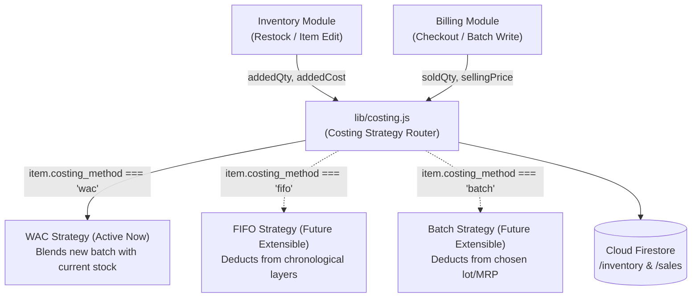

# Technical Specification & Implementation Plan: Inventory Costing (WAC) & Manual Barcode Management

**Document Version:** 1.0.0  
**Status:** Ready for Review  
**Author:** AI Engineering Pair  
**Target Architecture:** Cloud Firestore (Spark Free Tier) · Offline-First IndexedDB · Vanilla ES6  

---

## 1. Executive Summary & Objective

This specification details the architecture, data models, business logic, user experience, and phase-by-phase implementation plan for introducing **Cost Tracking (Moving Weighted Average Cost - WAC)**, **Profit Calculations**, and **Manual Barcode Management** to the Vikretha/Sumukha POS platform.

### Core Principles & Constraints
1. **Manual Entry Focused:** Barcode management is strictly designed around **manual keyboard entry** (typing barcodes in inventory forms and searching/entering barcodes at checkout). There is **no dependency** on camera scanning or USB hardware.
2. **Pluggable Costing Strategy:** Implemented using a Strategy Pattern (`lib/costing.js`) starting with **Moving Weighted Average Cost (WAC)**, while leaving clean interfaces for future support of **FIFO**, **Batch/Lot Tracking**, **per-item costing methods**, and **mid-stream migration wizards**.
3. **Inheritance with Overrides:** Items provide baseline selling price, purchase cost, and barcode. Color/size variants inherit these defaults unless explicitly overridden per variant.
4. **Zero-Breakage & Backward Compatibility:** Legacy items without barcodes or purchase costs will continue to function seamlessly without requiring database migrations.
5. **Spark Free Tier Compliant:** All calculations happen client-side; snapshotting and counters are bundled inside existing atomic batch writes. No Cloud Functions required.

---

## 2. Pluggable Costing Architecture

All financial calculations are isolated in a dedicated service (`lib/costing.js`), completely decoupled from the UI.



### Strategy Interface Contract
```javascript
// Interface that each costing method implements:
class CostingStrategy {
  // Calculates new item cost upon receiving fresh stock
  calculateRestockCost(currentStock, currentCost, addedQty, newBatchCost) {}
  
  // Resolves the cost of goods sold (COGS) for a line item during checkout
  resolveSaleCOGS(itemSnapshot, qtySold) {}
  
  // Handles returns or stock adjustments
  calculateAdjustment(currentStock, currentCost, adjustmentQty, reason) {}
}
```

---

## 3. Database Schema Specifications

### 3.1. Inventory Document (`/shops/{shopId}/inventory/{itemId}`)

```typescript
{
  // ── Existing Baseline Fields (Unchanged) ──
  name: string,                  // e.g. "Oxford Cotton Shirt"
  unit: string,                  // e.g. "pcs", "kg", "m"
  unitType: "pieces" | "other",
  stock: number,                 // Total aggregated quantity on hand
  price: number,                 // Default selling price / MRP
  threshold: number,             // Low stock alert threshold (default: 5)
  type?: string,                 // Category / Category tag
  brand?: string,                // Brand name
  color?: string,                // Standalone color string
  hasSizes: boolean,
  has_colors: boolean,
  has_sizes: boolean,
  
  // ── New Financial & Identification Fields (Optional) ──
  barcode?: string,              // Optional: Item-level barcode (e.g. "8901234567890")
  purchase_price?: number,       // Optional: Moving Weighted Average Cost (WAC) (e.g. 107.14)
  costing_method?: "wac" | "fifo" | "batch", // Defaults to "wac"
  
  // ── Size Variants Map (When hasSizes === true) ──
  sizes?: {
    [sizeKey: string]: {
      label: string,             // e.g. "XL", "42"
      color?: string | null,     // e.g. "Navy Blue"
      width?: string | null,
      psi?: string | null,
      stock: number,             // Variant-specific stock level
      
      // Variant Overrides (Optional — fall back to parent if omitted):
      barcode?: string,          // Optional: Variant-specific barcode
      price?: number,            // Optional: Variant selling price override
      purchase_price?: number    // Optional: Variant cost override
    }
  },
  
  // ── Color/Size Multi-dimensional Variants Array ──
  variants?: Array<{
    color: string,
    size?: string,
    qty: number,
    barcode?: string,            // Optional: Variant-specific barcode
    price?: number,              // Optional: Variant selling price override
    purchase_price?: number      // Optional: Variant cost override
  }>
}
```

### 3.2. Sales Document (`/shops/{shopId}/sales/{saleId}`)

Snapshots the cost and profit at the second of checkout for auditability:

```typescript
{
  saleId: string,                // e.g. "SAL-20261022-0001"
  timestamp: Timestamp,
  customer_name?: string,
  customer_phone?: string,
  payment_mode: "cash" | "upi" | "card" | "split",
  payment_split?: { cash?: number, upi?: number, card?: number },
  created_by: string,            // email of cashier/owner
  
  // ── Financial Totals ──
  subtotal: number,              // Gross sales before discount
  discount: number,              // Total discount applied
  total: number,                 // Net payable amount
  cogs: number,                  // Total Cost of Goods Sold for this bill
  gross_profit: number,          // Net Profit: (total - cogs)
  profit_margin_pct: number,      // (gross_profit / total) * 100
  
  // ── Item Line Snapshots ──
  items: Array<{
    item_id: string,
    name: string,
    unit: string,
    qty: number,
    price: number,               // Selling price charged per unit
    purchase_price: number,      // Snapshotted WAC cost per unit
    line_total: number,          // price * qty
    line_cost: number,           // purchase_price * qty
    line_profit: number,         // line_total - line_cost
    size_key?: string | null,
    size_label?: string | null,
    adhoc?: boolean
  }>
}
```

### 3.3. Daily & Monthly Summaries (`daily_summary/{YYYY-MM-DD}` & `monthly_summary/{YYYY-MM}`)

```typescript
{
  date: "2026-10-22",
  count: increment(1),
  revenue: increment(total),
  gross_profit: increment(gross_profit), // Atomic profit accumulator
  cogs: increment(cogs),
  last_updated: serverTimestamp()
}
```

---

## 4. Mathematical Logic & Algorithms

### 4.1. Moving Weighted Average Cost (WAC) Formula
When receiving fresh inventory:
- Let $S_{\text{old}}$ = Current stock on hand
- Let $C_{\text{old}}$ = Current purchase price (cost)
- Let $S_{\text{add}}$ = Incoming restock quantity
- Let $C_{\text{add}}$ = Purchase price of the new batch

$$\text{New WAC} = \begin{cases} 
C_{\text{add}} & \text{if } S_{\text{old}} \le 0 \text{ or } C_{\text{old}} \text{ is undefined} \\
\frac{(S_{\text{old}} \times C_{\text{old}}) + (S_{\text{add}} \times C_{\text{add}})}{S_{\text{old}} + S_{\text{add}}} & \text{if } S_{\text{old}} > 0 
\end{cases}$$

#### Worked Example:
- **Starting State:** 2 shirts in stock @ ₹100.00 each $\rightarrow$ Inventory valuation = ₹200.00
- **Restock Intake:** 5 shirts arrive @ ₹110.00 each $\rightarrow$ Batch valuation = ₹550.00
- **Calculation:**
  $$\text{New Unit Cost} = \frac{(2 \times 100) + (5 \times 110)}{2 + 5} = \frac{200 + 550}{7} = \frac{750}{7} = \mathbf{₹107.14}$$
- The item document's `stock` is set to `7`, and `purchase_price` is set to `107.14`.

### 4.2. Profit & Margin Calculations
- **Line Gross Profit:**
  $$\text{Line Profit} = \text{line\_total} - (\text{purchase\_price} \times \text{qty})$$
- **Total Sale Profit:**
  $$\text{Sale Gross Profit} = \text{total} - \sum (\text{item.purchase\_price} \times \text{item.qty})$$
  *(Discounts reduce net gross profit proportionally)*.
- **Profit Margin Percentage:**
  $$\text{Margin \%} = \frac{\text{Sale Gross Profit}}{\text{total}} \times 100$$

---

## 5. UI/UX Workflow & Interactions

### 5.1. Inventory Screen (`modules/inventory.js`)

#### A. Add / Edit Item Bottom-Sheet
1. **Manual Barcode Field:**
   - Text input positioned right below Name.
   - Placeholder: `"Enter or type barcode (optional)"`.
   - On blur, validates against existing items in memory: if another item already uses this barcode, shows an inline warning: `⚠️ Barcode already in use by "Linen Shirt"`.
2. **Purchase Price (Cost) Field:**
   - Number input adjacent to Selling Price:
     `[ Selling Price (₹) ]  [ Purchase Price / Cost (₹) ]`
   - Real-time **Margin Preview Badge**: As user types, shows `Margin: 56.5% (Profit: ₹140.00/pc)`.
3. **Restock Assistant Mode (In Edit Item):**
   - When editing an existing item with stock, an expandable **"Add Restock"** panel appears:
     - Input: `Added Qty (+)` and `Batch Cost Price (₹)`
     - Live preview: Shows `"Current: 2 @ ₹100. Adding: 5 @ ₹110 → Result: 7 @ ₹107.14"`.
     - Clicking "Apply Restock" updates stock and cost automatically.
4. **Variant Row Inputs (Size & Color):**
   - Each variant row expands or includes:
     - `Barcode` (optional)
     - `Price` (optional override; placeholder displays parent price)
     - `Cost` (optional override; placeholder displays parent cost)

#### B. Inventory Table Display
- Search box filters by **Item Name**, **Category**, **Brand**, or **Barcode**.
- Displays **Cost** and **Margin %** columns (visible only to authenticated Owner and Admin roles).

---

### 5.2. Billing Screen (`modules/billing.js`)

#### Manual Barcode Entry Workflow:
1. **Barcode Input Field:**
   - Placed prominently above or integrated into the item search bar:
     `[ 🏷️ Enter Barcode... (Press Enter) ]`
2. **Resolution Rules upon pressing Enter:**
   - **Case 1: Matches Variant Barcode:** Instantly adds that specific color & size to the cart with its specific price and cost. Shows brief success toast: `"Added: Oxford Shirt (XL · Blue)"`.
   - **Case 2: Matches Parent Barcode (Item has variants):** Automatically opens the Color & Size picker modal for the cashier to select the variant.
   - **Case 3: Matches Standalone Item (No variants):** Instantly adds 1 unit to cart.
   - **Case 4: No Match Found:** Clears input, focuses back, and displays toast: `"Barcode not found"`.
3. **Cart & Receipt:**
   - Normal billing flow remains 100% untouched for cashiers who prefer clicking product cards or searching by name.

---

### 5.3. Dashboard & Reports Screen

1. **Dashboard (`modules/dashboard.js`):**
   - Summary stat cards display:
     - `Today's Revenue` & `Today's Gross Profit` (e.g. `₹12,450 (Profit: ₹4,210 · 33.8%)`).
     - `Month Revenue` & `Month Profit`.
2. **Reports (`modules/reports.js`):**
   - Sales inspection modal shows:
     - `Line Cost` and `Line Profit` per row.
     - `Total Bill Profit` and `Margin %`.
   - Excel / CSV export includes `COGS`, `Gross Profit`, and `Margin %` columns.

---

## 6. Security Rules (`firestore.rules`)

The security rules must allow owners/admins to write the new fields, while maintaining strict cashier restrictions.

```javascript
match /shops/{shopId}/inventory/{itemId} {
  allow read: if isAuthorized(shopId);

  // Owners and Admins: Full management with validation
  allow create, update: if isOwnerOrAdmin(shopId)
    && request.resource.data.keys().hasAll(['name', 'unit', 'price', 'stock'])
    && request.resource.data.price > 0
    && request.resource.data.stock >= 0
    // Optional field guards:
    && (!('purchase_price' in request.resource.data) || request.resource.data.purchase_price >= 0)
    && (!('barcode' in request.resource.data) || request.resource.data.barcode is string);

  allow delete: if isOwnerOrAdmin(shopId);

  // Cashiers: Billing batch stock decrement only (unchanged and unblocked)
  allow update: if isAuthorized(shopId)
    && request.resource.data.name  == resource.data.name
    && request.resource.data.unit  == resource.data.unit
    && request.resource.data.price == resource.data.price
    && request.resource.data.stock is number;
}
```

---

## 7. Future-Proofing & Extensibility Architecture

How this implementation provides direct hooks for future capabilities:

1. **Per-Item Costing Method:**
   - Every inventory doc includes `costing_method: "wac"`.
   - To make an item use Batch Tracking in the future, simply set `costing_method: "batch"` on that document. The Strategy Router will automatically invoke the batch handler.
2. **Mid-Way Switching / Migration Wizard:**
   - Because `purchase_price` is stored on every item and snapshotted on every historical sale, switching from WAC to FIFO in the future only requires seeding an initial FIFO layer:
     `[{ qty: currentStock, cost: currentWAC, date: today }]`.
   - Historical sales are already snapshotted and will never be distorted by changing methods.
3. **Batch / Lot Tracking Integration:**
   - The data model allows adding a `batches: []` subcollection or array to any item in future updates without modifying the sales collection or WAC items.

---

## 8. Detailed Implementation Plan & Phases

| Phase | Description | Deliverables / Files Changed |
| :---: | :--- | :--- |
| **Phase 1** | **Costing Engine & Strategy Router** | • Create `lib/costing.js`<br>• Implement WAC math, margin formulas, barcode indexers, and validation helpers. |
| **Phase 2** | **Security Rules Update** | • Update `firestore.rules` to support optional `purchase_price`, `barcode`, `costing_method`.<br>• Verify cashier batch writes pass security checks. |
| **Phase 3** | **Inventory UI & Manual Barcodes** | • Update `modules/inventory.js`<br>• Add manual barcode & purchase price inputs to Item Modal.<br>• Add Restock Assistant for WAC intake.<br>• Add variant-level barcode and price/cost overrides.<br>• Add barcode duplicate checking on blur/save.<br>• Add barcode search matching to inventory search bar. |
| **Phase 4** | **Billing Barcode Entry & Profit Snapshots** | • Update `modules/billing.js`<br>• Add manual Barcode entry field with `Enter` key resolution.<br>• Snapshot `purchase_price`, `line_cost`, and `line_profit` in `cartArr`.<br>• Write `cogs` and `gross_profit` to `sales/{saleId}`.<br>• Atomically increment `gross_profit` and `cogs` in `daily_summary` and `monthly_summary`. |
| **Phase 5** | **Reports & Dashboard Analytics** | • Update `modules/dashboard.js` with Profit KPI cards.<br>• Update `modules/reports.js` sale detail drawer with line cost/profit.<br>• Update CSV/Excel export with Profit and Cost columns. |
| **Phase 6** | **End-to-End Verification** | • Test manual barcode entry and resolution.<br>• Test restock calculation with user's exact case (2 @ 100 + 5 @ 110 = 7 @ 107.14).<br>• Test variant overrides and fallbacks.<br>• Verify offline billing and backward compatibility with legacy items. |

---

## 9. Next Steps
Once you review and approve this document, execution will begin systematically according to the phases above.
