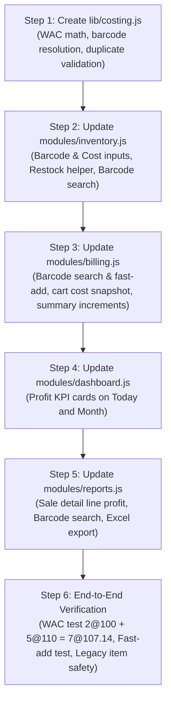

# Implementation Guide: Item-Level Purchase Price (WAC), Profit Tracking & Manual Barcode

**Document Version:** 1.0.0  
**Status:** Approved for Implementation  
**Scope:** Item-level only (Variant-level color/size deferred for next phase)  
**Target:** Cloud Firestore (Spark Free Tier) · Offline-First IndexedDB · Vanilla ES6  

---

## 1. Executive Summary & Core Principles

This document specifies the exact implementation details for adding **Item-Level Cost Tracking (Moving Weighted Average Cost)**, **Sale Profit Snapshotting**, and **Manual Barcode Management** to Vikretha / Sumukha POS.

### Core Rules
1. **Strictly Manual Barcode Entry:** Barcode input is designed for keyboard typing and manual entry in forms and checkout search (no camera or USB hardware dependencies).
2. **Cost Snapshotting on Every Sale:** When an item is sold, its current `purchase_price` is permanently snapshotted into the sale bill document (`line_cost`, `line_profit`, `cogs`, `gross_profit`). Future price changes will never distort historical financial records.
3. **Moving Weighted Average Cost (WAC):** Restocking items at a new purchase price automatically blends the cost:
   $$\text{New Cost} = \frac{(S_{\text{old}} \times C_{\text{old}}) + (S_{\text{add}} \times C_{\text{add}})}{S_{\text{old}} + S_{\text{add}}}$$
4. **100% Backward Compatible:** Items without a barcode or purchase price continue to function without errors. Profit defaults gracefully to N/A or revenue.
5. **Pluggable Costing Architecture:** All costing and barcode logic resides in `lib/costing.js` using the Strategy Pattern to allow adding FIFO or Batch tracking in the future without UI rewrites.

---

## 2. Field Naming & Terminology Standard

| Field Name | Type | Belongs To | Definition |
| :--- | :--- | :--- | :--- |
| `purchase_price` | `number` | Inventory Item | The unit purchase cost paid to the supplier (WAC). |
| `barcode` | `string` | Inventory Item | Manual barcode number / code (e.g. `"8901234567890"`). |
| `cogs` | `number` | Sale Document | **Cost of Goods Sold:** Sum of all item purchase costs for this bill. |
| `gross_profit` | `number` | Sale Document | `total - cogs` (Actual net profit earned on this bill). |
| `profit_margin_pct` | `number` | Sale Document | `(gross_profit / total) * 100` (Profit margin percentage). |
| `line_cost` | `number` | Sale Item Line | `purchase_price * qty` (Total cost for that specific row). |
| `line_profit` | `number` | Sale Item Line | `line_total - line_cost` (Profit for that specific row). |

---

## 3. Database Schema Contracts

### A. Inventory Document (`/shops/{shopId}/inventory/{itemId}`)
```typescript
{
  name: "Oxford Cotton Shirt",
  unit: "pcs",
  stock: 7,                     // Total quantity
  price: 250,                   // Selling price (MRP)
  threshold: 5,
  
  // ── New Fields (Optional / Backward-Compatible) ──
  barcode: "8901234567890",     // Optional: Item barcode
  purchase_price: 107.14,       // Optional: Moving Weighted Average Cost (WAC)
  costing_method: "wac"         // Defaults to 'wac' (future-proofing)
}
```

### B. Sales Document (`/shops/{shopId}/sales/{saleId}`)
```typescript
{
  saleId: "SAL-20261023-0001",
  timestamp: serverTimestamp(),
  total: 500.00,
  subtotal: 500.00,
  discount: 0.00,
  payment_mode: "cash",
  
  // ── Snapshotted Financial Totals ──
  cogs: 214.28,                 // Preserved forever: total cost of goods
  gross_profit: 285.72,         // Preserved forever: total profit
  profit_margin_pct: 57.14,     // Preserved forever: margin %
  
  items: [
    {
      item_id: "inv_shirt_123",
      name: "Oxford Cotton Shirt",
      unit: "pcs",
      qty: 2,
      price: 250.00,            // Selling price charged
      purchase_price: 107.14,   // 🔒 Snapshotted unit cost at time of sale
      line_total: 500.00,       // price * qty
      line_cost: 214.28,        // purchase_price * qty
      line_profit: 285.72       // line_total - line_cost
    }
  ]
}
```

### C. Daily & Monthly Summaries (`daily_summary` / `monthly_summary`)
```typescript
{
  date: "2026-10-23",
  count: increment(1),
  revenue: increment(total),
  gross_profit: increment(gross_profit), // Atomic profit accumulator
  cogs: increment(cogs),                 // Atomic cost accumulator
  last_updated: serverTimestamp()
}
```

---

## 4. Detailed UI & Module Changes

### 4.1. Core Service: `lib/costing.js` (New File)
* `computeWAC(currentStock, currentCost, addedQty, newBatchCost)`:
  - If `currentStock <= 0` or `!currentCost` $\rightarrow$ returns `newBatchCost`.
  - If `currentStock > 0` $\rightarrow$ returns `((currentStock * currentCost) + (addedQty * newBatchCost)) / (currentStock + addedQty)`.
* `calculateSaleFinancials(cartItems, totalSaleAmount)`:
  - Computes `cogs`, `gross_profit`, and `profit_margin_pct`.
* `findItemByBarcode(inventoryItems, barcode)`:
  - Exact match lookup helper.
* `isBarcodeDuplicate(inventoryItems, barcode, currentItemId)`:
  - Returns boolean if barcode is already claimed by another item.

---

### 4.2. Inventory Management: `modules/inventory.js`
1. **Item Modal (Add & Edit):**
   - **Barcode Input:** Text input right below name: `[ 🏷️ Barcode (Optional) ]`.
     - Validates on blur: shows inline error if duplicate barcode exists.
   - **Purchase Price Input:** Number input next to Selling Price: `[ Purchase Price / Cost (₹) ]`.
   - **Margin Preview:** As user enters selling price and cost, shows live badge: `Margin: 57.1% (Profit: ₹142.86/pc)`.
   - **Restock Assistant (Edit Mode):** When editing stock, an expandable button **"+ Restock"** shows:
     - `Added Qty (+)` and `Batch Cost Price (₹)`
     - Live preview: `"Current: 2 @ ₹100. Adding: 5 @ ₹110 → Result: 7 @ ₹107.14"`.
     - Clicking "Apply" updates the stock and purchase price fields automatically.
2. **Inventory Table & Cards:**
   - Display barcode badge under item name: `🏷️ 8901234567890`.
   - Display Cost and Margin % next to Price (visible to owner/admin).
3. **Inventory Search:**
   - Update `_renderList` filter to match `it.name` OR `it.barcode`.

---

### 4.3. Billing Module: `modules/billing.js`
1. **Search & Fast-Add:**
   - `#product-search` matches both item name and barcode.
   - **Fast-Add on Enter:** When cashier enters an exact barcode and hits `Enter`:
     - Instantly adds 1 unit to cart (or increments quantity).
     - Shows toast notification: `Added: Oxford Cotton Shirt`.
     - Clears the search box immediately for the next entry.
2. **Cart Financial Snapshot:**
   - Cart item records `purchase_price: Number(inv.purchase_price || 0)`.
   - `line_cost` = `purchase_price * qty`.
   - `line_profit` = `line_total - line_cost`.
3. **Batch Checkout Write:**
   - Writes `cogs`, `gross_profit`, and `profit_margin_pct` to `sales/{saleId}`.
   - Atomically increments `gross_profit` and `cogs` on `daily_summary/{today}` and `monthly_summary/{month}`.

---

### 4.4. Dashboard: `modules/dashboard.js`
1. Reads `gross_profit` from `daily_summary` and `monthly_summary`.
2. Updates summary cards:
   - **Today Card:** Displays Revenue + Today's Profit: `Profit: ₹3,420 (42% margin)`.
   - **This Month Card:** Displays Monthly Revenue + Month's Profit.

---

### 4.5. Reports: `modules/reports.js`
1. **Bill Search:** Search filter matches items inside the bill by `barcode` as well as bill ID and customer name.
2. **Sale Inspection Drawer:**
   - Each item row shows `Unit Cost`, `Line Cost`, and `Line Profit`.
   - Bill summary section shows `Total COGS`, `Gross Profit`, and `Margin %`.
3. **Excel / CSV Export:**
   - Appends `COGS`, `Gross Profit`, and `Margin %` columns to the exported spreadsheet.

---

## 5. Step-by-Step Execution Plan


