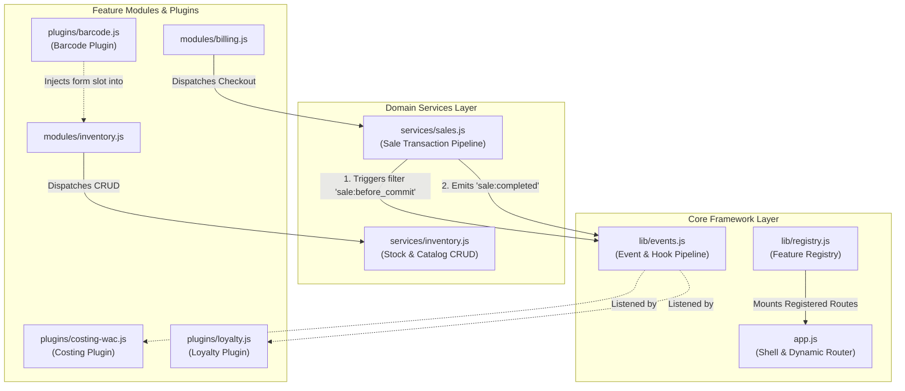

# Technical Specification & Architecture Blueprint: Plug-and-Play Extensible Architecture

**Document Version:** 1.0.0  
**Status:** Proposed / Ready for Review  
**Author:** AI Engineering Pair  
**Target Platform:** Cloud Firestore (Spark Free Tier) · Offline-First IndexedDB · Vanilla ES6 Modules · GitHub Pages  
**Related Specs:**
- [ADR-0001: Firestore Data Architecture](file:///home/puneethkanna/projects/InternalProjects/PersonalProjects/sumukha/docs/adr/adr-0001-firestore-data-architecture.md)
- [TRD: Inventory Pricing & Barcode Spec](file:///home/puneethkanna/projects/InternalProjects/PersonalProjects/sumukha/docs/trd/inventory-pricing-barcode-spec.md)
- [Vikretha Technical Requirements Document](file:///home/puneethkanna/projects/InternalProjects/PersonalProjects/sumukha/docs/trd/vikretha-trd.md)

---

## 1. Executive Summary & Objective

The objective of this specification is to define an evolutionary transition plan for the **Vikretha / Sumukha** architecture into a **Plug-and-Play (Open-Closed) Architecture**:
> **Core Tenet:** *Any new feature (e.g. Barcode Scanning, Inventory Costing, Customer Loyalty, GST / Tax, Multi-printer support) can be plugged in or unplugged without modifying, destabilizing, or introducing regression bugs into existing core functionality.*

All design decisions strictly adhere to the project's non-negotiable operational constraints:
1. **Zero-Cost:** Runs entirely on Firebase Spark (Free Plan) and GitHub Pages.
2. **Zero-Build:** Pure browser-native Vanilla ES6 Modules (`import` / `export`) without Vite, Webpack, Babel, or npm compilation steps.
3. **Offline-First:** All read/write persistence handled seamlessly via IndexedDB queues.
4. **Fork-and-Go:** Simple single-file configuration via [`shop.config.js`](file:///home/puneethkanna/projects/InternalProjects/PersonalProjects/sumukha/shop.config.js).

---

## 2. Existing Architecture Alignment Audit

### 2.1 Alignment Scorecard: 36% (Partially Aligned)

| Architectural Dimension | Alignment | Current Status | Target Plug-and-Play State |
| :--- | :---: | :--- | :--- |
| **1. Dynamic Route & Nav Registry** | **35%** | Hardcoded route tables, navigation items, icons, and titles directly inside [`app.js`](file:///home/puneethkanna/projects/InternalProjects/PersonalProjects/sumukha/app.js). | Self-registering feature modules (`lib/registry.js`). Shell discovers and mounts routes dynamically. |
| **2. Inter-Module Event Bus (Pub-Sub)** | **10%** | Completely missing. Core workflows directly trigger all secondary writes (e.g., [`billing.js`](file:///home/puneethkanna/projects/InternalProjects/PersonalProjects/sumukha/modules/billing.js) writes summaries, customer contact, and ad-hoc modals directly). | Lightweight event bus (`lib/events.js`). Billing emits `sale:completed`; external plugins listen and react independently. |
| **3. Separation of Concerns (UI vs Domain)** | **25%** | 1,400+ line UI modules ([`billing.js`](file:///home/puneethkanna/projects/InternalProjects/PersonalProjects/sumukha/modules/billing.js), [`inventory.js`](file:///home/puneethkanna/projects/InternalProjects/PersonalProjects/sumukha/modules/inventory.js)) intertwine HTML templating, DOM listeners, validation, and Firestore batch commits. | Dedicated domain service layer ([`services/sales.js`](file:///home/puneethkanna/projects/InternalProjects/PersonalProjects/sumukha/services/sales.js), [`services/inventory.js`](file:///home/puneethkanna/projects/InternalProjects/PersonalProjects/sumukha/services/inventory.js)). Pure UI components call clean service interfaces. |
| **4. Extensibility Slots & UI Hooks** | **15%** | Hardcoded form templates. Adding a field requires rewriting existing template literals and form submission logic. | Slot/hook system allowing feature plugins to inject inputs, table columns, or action buttons. |
| **5. Business Rule Strategy Isolation** | **55%** | Planned for Costing in [`inventory-pricing-barcode-spec.md`](file:///home/puneethkanna/projects/InternalProjects/PersonalProjects/sumukha/docs/trd/inventory-pricing-barcode-spec.md), but missing for payments, pricing, and discounts. | Pluggable Strategy Pattern across payments, discounts, costing, and exports. |
| **6. Schema & Data Extensibility** | **75%** | Firestore NoSQL documents support non-breaking optional fields (`variants`, `barcode`, `purchase_price`). | Document schemas remain additive and backward-compatible with legacy records. |

---

### 2.2 Critical Anti-Patterns in Current Architecture

#### Anti-Pattern A: Monolithic Coupling in [`billing.js`](file:///home/puneethkanna/projects/InternalProjects/PersonalProjects/sumukha/modules/billing.js)
Lines 1205–1280 of [`billing.js`](file:///home/puneethkanna/projects/InternalProjects/PersonalProjects/sumukha/modules/billing.js) directly execute a batch write affecting 5 disparate domains:
- `/sales/{id}` (Sale creation)
- `/inventory/{itemId}` (Stock deduction)
- `/daily_summary/{today}` (Daily analytics aggregate)
- `/monthly_summary/{month}` (Monthly analytics aggregate)
- `/customers/{phone}` (Customer contact book upsert)
- Ad-hoc item modal triggers

```
Current Coupled Flow:
User Taps "Submit Sale"
       │
       ▼
   billing.js ──(Direct Write)──► /sales
       │ ───────(Direct Write)──► /inventory
       │ ───────(Direct Write)──► /daily_summary
       │ ───────(Direct Write)──► /monthly_summary
       │ ───────(Direct Write)──► /customers
       │ ───────(Direct Prompt)─► Ad-hoc Modal
       ▼
[Any new feature requires editing billing.js at line 1200+]
```
*Risk:* Any modification or bug introduced while adding features (such as WAC Costing or Loyalty) jeopardizes core checkout.

#### Anti-Pattern B: Hardcoded Route Tables in [`app.js`](file:///home/puneethkanna/projects/InternalProjects/PersonalProjects/sumukha/app.js)
[`app.js`](file:///home/puneethkanna/projects/InternalProjects/PersonalProjects/sumukha/app.js#L27-L32) hardcodes:
- `NAV_ITEMS` (Dashboard, Billing, Inventory, Reports)
- `PROTECTED_ROUTES` array
- `NAV_ICONS` SVGs
- `_routeTitles` mapping
- Manual DOM injection for role-specific routes (`_injectRoleNav` for Settings)

*Risk:* New features cannot be dropped in as independent modules without modifying 4–5 core locations in [`app.js`](file:///home/puneethkanna/projects/InternalProjects/PersonalProjects/sumukha/app.js).

---

## 3. The Target "Plug-and-Play" Architecture



---

## 4. Technical Specifications & Contract Interfaces

### 4.1 Event Bus & Hook Pipeline (`lib/events.js`)

A lightweight, zero-dependency Pub-Sub and Filter pipeline:

```javascript
/**
 * lib/events.js — Zero-dependency Event Bus and Filter Hook Engine
 */
class EventBus {
  constructor() {
    this._listeners = new Map();
    this._filters   = new Map();
  }

  /**
   * Subscribe to an event (Asynchronous/Fire-and-forget side effects)
   */
  on(event, handler) {
    if (!this._listeners.has(event)) this._listeners.set(event, []);
    this._listeners.get(event).push(handler);
    return () => this.off(event, handler);
  }

  off(event, handler) {
    const list = this._listeners.get(event) || [];
    this._listeners.set(event, list.filter(fn => fn !== handler));
  }

  /**
   * Emit an event to all subscribers without blocking execution
   */
  emit(event, payload) {
    const list = this._listeners.get(event) || [];
    for (const fn of list) {
      try {
        fn(payload);
      } catch (err) {
        console.error(`[EventBus] Error in listener for "${event}":`, err);
      }
    }
  }

  /**
   * Register a data transformation filter
   */
  addFilter(hookName, filterFn, priority = 10) {
    if (!this._filters.has(hookName)) this._filters.set(hookName, []);
    this._filters.get(hookName).push({ fn: filterFn, priority });
    this._filters.get(hookName).sort((a, b) => a.priority - b.priority);
  }

  /**
   * Pass data through registered filter pipelines sequentially
   */
  async applyFilter(hookName, initialValue, context = {}) {
    const list = this._filters.get(hookName) || [];
    let value = initialValue;
    for (const item of list) {
      try {
        value = await item.fn(value, context);
      } catch (err) {
        console.error(`[EventBus] Filter error in "${hookName}":`, err);
      }
    }
    return value;
  }
}

export const events = new EventBus();
```

---

### 4.2 Feature Module Registry (`lib/registry.js`)

Decouples navigation and routing from [`app.js`](file:///home/puneethkanna/projects/InternalProjects/PersonalProjects/sumukha/app.js):

```javascript
/**
 * lib/registry.js — Self-Registering Module & Route Registry
 */
const _modules = new Map();

export function registerModule({
  id,
  route,
  label,
  iconSvg,
  render,
  roles = ['owner', 'admin', 'staff'],
  order = 100,
  showInNav = true,
  enabled = true
}) {
  if (!enabled) return;
  _modules.set(id, { id, route, label, iconSvg, render, roles, order, showInNav });
}

export function getRegisteredModules(userRole = 'staff') {
  return [..._modules.values()]
    .filter(m => !m.roles || m.roles.includes(userRole))
    .sort((a, b) => a.order - b.order);
}

export function getModuleByRoute(route) {
  return [..._modules.values()].find(m => m.route === route);
}
```

#### How [`app.js`](file:///home/puneethkanna/projects/InternalProjects/PersonalProjects/sumukha/app.js) Becomes a Pure Shell:
```javascript
// app.js — Rendering Navigation dynamically
function mountAppShell(userRole) {
  const modules = getRegisteredModules(userRole).filter(m => m.showInNav);
  
  navContainer.innerHTML = modules.map(m => `
    <a href="#/${m.route}" data-route="${m.route}" class="sidebar-nav-item">
      ${m.iconSvg || ''} ${m.label}
    </a>
  `).join('');
}

// app.js — Route Dispatcher
async function handleRoute() {
  const route = (window.location.hash.replace('#/', '') || 'dashboard').split('/')[0];
  const modDef = getModuleByRoute(route);
  if (!modDef) {
    // 404 or fallback
    return;
  }
  
  const content = document.getElementById('app-content');
  modDef.render(content);
}
```

---

### 4.3 Domain Service Layer (`services/sales.js`)

Isolates checkout business logic and Firestore batch writes from the DOM:

```javascript
/**
 * services/sales.js — Clean checkout service
 */
import { db, auth } from '../lib/firebase-init.js';
import { doc, writeBatch, increment, serverTimestamp } from 'https://www.gstatic.com/firebasejs/10.12.0/firebase-firestore.js';
import { SHOP_ID } from '../shop.config.js';
import { events } from '../lib/events.js';

export async function processSale({ saleId, cartItems, subtotal, discount, total, customer, payment }) {
  // 1. Filter Hook: Allow plugins to modify/augment sale before commit (e.g. tax, WAC cost COGS)
  const salePayload = await events.applyFilter('sale:before_commit', {
    saleId,
    timestamp: serverTimestamp(),
    items: cartItems,
    subtotal,
    discount,
    total,
    customer_name: customer?.name || '',
    customer_phone: customer?.phone || '',
    payment_mode: payment.mode,
    payment_split: payment.split || null,
    created_by: auth.currentUser?.email ?? null
  });

  const batch = writeBatch(db);

  // 2. Write Sale Document
  const saleRef = doc(db, 'shops', SHOP_ID, 'sales', saleId);
  batch.set(saleRef, salePayload);

  // 3. Decrement Inventory
  for (const item of cartItems) {
    if (!item.item_id || item.adhoc) continue;
    const invRef = doc(db, 'shops', SHOP_ID, 'inventory', item.item_id);
    if (item.size_key) {
      batch.update(invRef, { [`sizes.${item.size_key}.stock`]: increment(-item.qty) });
    } else {
      batch.update(invRef, { stock: increment(-item.qty) });
    }
  }

  // 4. Update Summary Aggregates
  const today = new Date().toISOString().slice(0, 10);
  const dailyRef = doc(db, 'shops', SHOP_ID, 'daily_summary', today);
  batch.set(dailyRef, {
    date: today,
    count: increment(1),
    revenue: increment(total),
    last_updated: serverTimestamp()
  }, { merge: true });

  const month = today.slice(0, 7);
  const monthlyRef = doc(db, 'shops', SHOP_ID, 'monthly_summary', month);
  batch.set(monthlyRef, {
    month,
    count: increment(1),
    revenue: increment(total),
    last_updated: serverTimestamp()
  }, { merge: true });

  // 5. Commit Batch (returns immediately when offline)
  await batch.commit();

  // 6. Broadcast Event (Plugins handle customer book, notifications, costing without touching billing.js)
  events.emit('sale:completed', {
    saleId,
    sale: salePayload,
    cartItems,
    customer,
    payment
  });

  return saleId;
}
```

---

### 4.4 UI Slot & Hook Engine (`lib/slots.js`)

Allows plugins to inject custom UI elements into standard screens without editing form files:

```javascript
/**
 * lib/slots.js — Dynamic UI Slot Registry
 */
const _slots = new Map();

export function registerSlot(slotName, renderFn, priority = 10) {
  if (!_slots.has(slotName)) _slots.set(slotName, []);
  _slots.get(slotName).push({ renderFn, priority });
  _slots.get(slotName).sort((a, b) => a.priority - b.priority);
}

export function renderSlot(slotName, context = {}) {
  const providers = _slots.get(slotName) || [];
  return providers.map(p => p.renderFn(context)).join('\n');
}
```

*Example in `inventory.js` Form:*
```javascript
// Inside Inventory Item Modal form:
`<div class="form-grid">
   ${renderBasicFields(item)}
   <!-- Extensible Plug-and-Play Slot -->
   ${renderSlot('inventory:item_modal_fields', { item })}
 </div>`
```

---

## 5. Case Study: Adding Features Under Both Architectures

### Scenario: Adding Moving Weighted Average Cost (WAC) & Manual Barcode

| Step | Monolithic (Current) | Plug-and-Play (Proposed) |
| :--- | :--- | :--- |
| **1. UI Fields** | Modify [`inventory.js`](file:///home/puneethkanna/projects/InternalProjects/PersonalProjects/sumukha/modules/inventory.js) template literals, table headers, table rows, and modal submit handlers directly. | `registerSlot('inventory:item_modal_fields', (ctx) => renderCostAndBarcodeFields(ctx))` in `plugins/costing-wac.js`. Zero edits to [`inventory.js`](file:///home/puneethkanna/projects/InternalProjects/PersonalProjects/sumukha/modules/inventory.js). |
| **2. Search Matching** | Rewrite the search regex and input event listener in [`billing.js`](file:///home/puneethkanna/projects/InternalProjects/PersonalProjects/sumukha/modules/billing.js#L98). | Register filter: `events.addFilter('billing:filter_items', (items, query) => matchBarcodeOrName(items, query))`. |
| **3. Financial Calculation** | Directly add cost calculations into the middle of the checkout batch write in [`billing.js`](file:///home/puneethkanna/projects/InternalProjects/PersonalProjects/sumukha/modules/billing.js#L1210). | Standalone strategy in `lib/costing.js` augments sale via `sale:before_commit` and adjusts inventory via `inventory:restock`. |
| **4. Feature Flagging** | Not possible without manual commenting out of code blocks. | Set `features: { costing: false }` in [`shop.config.js`](file:///home/puneethkanna/projects/InternalProjects/PersonalProjects/sumukha/shop.config.js). |

---

## 6. Implementation & Migration Roadmap

The migration is designed as **purely additive** (zero disruption to existing operations):

```
┌────────────────────────┐      ┌────────────────────────┐      ┌────────────────────────┐
│ Phase 1: Event Bus     │ ───► │ Phase 2: Registry      │ ───► │ Phase 3: Services      │
│ Add lib/events.js      │      │ Add lib/registry.js    │      │ Extract services/      │
│ Zero breaking changes  │      │ Self-register modules  │      │ Decouple batch writes  │
└────────────────────────┘      └────────────────────────┘      └────────────────────────┘
```

### Phase 1: Foundation (Zero Disruption)
- Create [`lib/events.js`](file:///home/puneethkanna/projects/InternalProjects/PersonalProjects/sumukha/lib/events.js) and [`lib/slots.js`](file:///home/puneethkanna/projects/InternalProjects/PersonalProjects/sumukha/lib/slots.js).
- Add `events.emit()` calls at key lifecycle junctions in [`billing.js`](file:///home/puneethkanna/projects/InternalProjects/PersonalProjects/sumukha/modules/billing.js) and [`inventory.js`](file:///home/puneethkanna/projects/InternalProjects/PersonalProjects/sumukha/modules/inventory.js).
- Existing functionality remains 100% untouched.

### Phase 2: Dynamic Module Registry
- Create [`lib/registry.js`](file:///home/puneethkanna/projects/InternalProjects/PersonalProjects/sumukha/lib/registry.js).
- Have existing modules ([`dashboard.js`](file:///home/puneethkanna/projects/InternalProjects/PersonalProjects/sumukha/modules/dashboard.js), [`billing.js`](file:///home/puneethkanna/projects/InternalProjects/PersonalProjects/sumukha/modules/billing.js), [`inventory.js`](file:///home/puneethkanna/projects/InternalProjects/PersonalProjects/sumukha/modules/inventory.js), [`reports.js`](file:///home/puneethkanna/projects/InternalProjects/PersonalProjects/sumukha/modules/reports.js), [`settings.js`](file:///home/puneethkanna/projects/InternalProjects/PersonalProjects/sumukha/modules/settings.js)) export a module descriptor.
- Simplify [`app.js`](file:///home/puneethkanna/projects/InternalProjects/PersonalProjects/sumukha/app.js) to consume the registry.

### Phase 3: Extract Domain Services
- Create `services/sales.js` and `services/inventory.js`.
- Move customer upsert and ad-hoc saves out of `billing.js` into standalone event subscribers.

### Phase 4: Pluggable Features
- Implement the WAC Costing and Manual Barcode specifications ([`inventory-pricing-barcode-spec.md`](file:///home/puneethkanna/projects/InternalProjects/PersonalProjects/sumukha/docs/trd/inventory-pricing-barcode-spec.md)) using the new Event Bus and Strategy interfaces.
